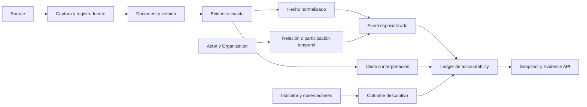
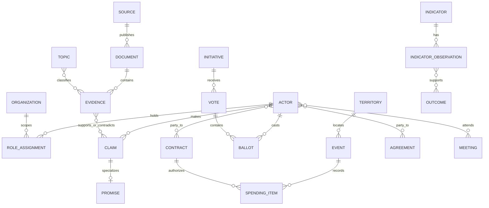

# Core ontology v1

Estado: `v1 estable para vocabulario e invariantes; mapeos fisicos aditivos`

Fecha: `2026-08-19`

Contrato máquina: `docs/data-model/core-ontology-v1.json`

## 1. Propósito

Esta ontología define el vocabulario común para conectar quién actúa, qué dice,
qué decide, qué dinero mueve, con quién se relaciona y qué resultados públicos se
observan. Su fin es permitir que conectores, revisores, publicadores y consumidores
externos compartan el mismo contrato sin acoplarse a una tabla concreta.

La ontología no reemplaza de golpe `etl/load/sqlite_schema.sql`. Ordena su evolución
aditiva. Las tablas actuales siguen siendo la fuente física de verdad hasta que una
migración concreta tenga datos reales, reconciliación y pruebas.

Principios:

1. Un hecho oficial y una interpretación son objetos distintos.
2. Toda afirmación derivada llega a evidencia exacta y a un registro fuente.
3. La ausencia de evidencia es `unknown` o `no_signal`; nunca una imputación.
4. La identidad entre fuentes no se deduce solo por nombre.
5. Un evento ocurrido, un documento publicado y una observación capturada tienen
   tiempos diferentes.
6. El contrato debe soportar `10M+` hechos y `1M+` documentos sin cambiar IDs ni
   URLs públicas; `100M+` exige más particiones y workers, no otra ontología.
7. No se usa información sintética, mock, generada o placeholder como dato,
   cobertura, evidencia o prueba de escala.
8. La información personal publicada por una fuente oficial se conserva completa,
   con procedencia. Solo se excluyen secretos, sesiones privadas, trazas de
   workstation y datos no públicos.

## 2. Alcance y estabilidad

### Estable en v1

- nombres y significado de los 19 conceptos nucleares;
- política de IDs, tiempo, versionado, procedencia e incertidumbre;
- separación entre hechos fuente, evidencia, afirmaciones y resultados derivados;
- semántica de las relaciones enumeradas en este documento;
- regla de publicación de identidad oficial pública;
- compatibilidad aditiva y reglas de escala.

Un cambio incompatible en cualquiera de estos puntos requiere `core_ontology_v2`.

### Experimental en v1

- nombres finales de nuevas tablas físicas;
- campos específicos que se definirán en las specs de promesas, gasto, acuerdos,
  influencia, geopolítica e indicadores;
- reglas de entity resolution entre fuentes;
- clasificación automática, scoring, detección de anomalías y causalidad;
- formas de transporte del futuro Evidence API.

Estos elementos pueden evolucionar de forma aditiva mientras preserven los IDs,
la procedencia y las relaciones públicas ya emitidas.

### Fuera de alcance

- declarar corrupción, ilegalidad, intención o culpa a partir de un score;
- inferir causalidad entre una acción y un outcome sin diseño metodológico;
- fusionar personas u organizaciones por similitud de nombre;
- convertir catálogo, noticia o agregador en sustituto silencioso de la fuente
  primaria;
- almacenar millones de PDFs o payloads grandes como BLOB dentro de SQLite.

## 3. Capas del modelo



Separación obligatoria:

- **captura**: bytes y metadatos tal como llegaron;
- **registro fuente**: identidad/versiones de la unidad publicada por el origen;
- **documento**: manifest y versiones de un artefacto legible;
- **evidencia**: fragmento o localizador concreto;
- **hecho**: valor normalizado que el origen afirma;
- **interpretación**: claim, clasificación, enlace o señal con método explícito;
- **agregado**: resultado recomputable desde hechos e interpretaciones;
- **publicación**: vista inmutable y verificable de una versión anterior.

Ninguna capa posterior puede sobrescribir la anterior.

## 4. Contrato común de IDs

### 4.1 Dos IDs, dos funciones

Cada concepto persistido usa:

- `*_pk`: entero local opcional para joins rápidos en SQLite;
- `*_id`: identificador textual público, estable y portable.

El PK local puede cambiar durante una reconstrucción. El ID público no.

### 4.2 IDs source-scoped

Cuando el origen publica un identificador estable, el ID se deriva de:

`entity_type + source_id + source_native_id + source_scope`

La serialización canónica se normaliza como UTF-8, sin espacios periféricos y con
claves en orden. El ID público recomendado es UUIDv5 dentro del namespace del
proyecto, expuesto como:

`urn:vclc:<entity_type>:<uuid>`

El tuple canónico completo se conserva en campos separados. El hash o UUID no
reemplaza el identificador oficial visible.

### 4.3 IDs sin identificador oficial

- Se crea una occurrence source-scoped usando el registro fuente, ordinal estable
  y ámbito.
- Nunca se usa solo nombre, título o texto libre.
- Dos occurrences parecidas siguen separadas hasta que una resolución explícita
  las una.

### 4.4 Identidad canónica entre fuentes

- Un `actor_id` resuelto se acuña una vez y se mantiene en un registry append-only.
- La unión exige identificador oficial compartido o decisión revisada con evidencia.
- Cada merge conserva aliases, IDs previos, método, fecha, reviewer y evidencia.
- Un split o corrección no borra historia: supersede la resolución anterior.
- Candidatura, persona, cargo, mandato y voto nominal son hechos distintos.

### 4.5 Idempotencia

Toda ingesta define una clave natural explícita. Regla general:

`UNIQUE(source_id, source_record_id, semantic_ordinal_or_version)`

Un replay del mismo payload no crea un hecho nuevo. Un payload distinto crea una
nueva versión u observación; no reescribe el pasado.

## 5. Contrato temporal

Todos los timestamps son ISO 8601. Los instantes se guardan en UTC con `Z` o offset.
Las fechas oficiales sin hora se conservan como `YYYY-MM-DD`; no se inventa hora.

| Campo | Significado | Regla |
|---|---|---|
| `occurred_at` / `occurred_on` | cuándo sucedió el evento | fecha del hecho, no de descarga |
| `valid_from`, `valid_to` | intervalo en que una relación o versión fue válida | extremos abiertos permitidos |
| `published_at` / `published_on` | cuándo lo publicó el origen | preservar precisión fuente |
| `effective_from`, `effective_to` | vigencia jurídica u operativa | no confundir con publicación |
| `observed_at` | cuándo el pipeline vio el estado | obligatorio por observación |
| `fetched_at` | cuándo se descargaron los bytes | obligatorio si hubo fetch |
| `source_snapshot_date` | corte lógico solicitado al origen | fecha, no reloj de ejecución |
| `created_at` | primera persistencia local del objeto | append-only cuando aplica |
| `updated_at` | última actualización del registro local | no prueba cambio del origen |
| `superseded_at` | cuándo otra versión dejó esta obsoleta | nunca implica borrado |

Campos auxiliares cuando el origen es impreciso:

- `time_precision`: `instant`, `day`, `month`, `year`, `interval`, `unknown`;
- `timezone`: zona publicada o inferida, con método;
- `date_text`: valor exacto fuente cuando no puede normalizarse;
- `temporal_confidence`: confianza en un enlace temporal derivado.

La consulta histórica debe usar `valid_from <= t` y
`valid_to IS NULL OR valid_to > t`. Nunca se atribuye a una persona el partido,
cargo u organización que tuvo fuera de la fecha del hecho.

## 6. Contrato de procedencia

Toda fila factual o derivada debe poder resolver esta cadena:

`source -> source_record/version -> raw object/document -> evidence -> normalized object/relationship -> published snapshot`

Campos mínimos:

- `source_id`;
- `source_record_id` o `source_record_pk`;
- `source_url` público, si existe;
- `source_snapshot_date` y `observed_at`;
- `content_sha256` del payload o referencia al objeto content-addressed;
- `extractor_method` y `extractor_version` para transformaciones;
- `evidence_id` o relación N:M a evidencias;
- `created_at`, `updated_at`;
- `raw_payload` o ruta/hash a la versión exacta.

Para PDF/HTML/texto:

- `document_id` y `document_version_id`;
- `page`, `section`, `paragraph`, `char_start`, `char_end` o selector equivalente;
- cita exacta cuando sea legal y operacionalmente útil;
- hash del texto/fragmento;
- método de extracción, OCR y flags de calidad.

Para relaciones derivadas:

- `method` y `method_version`;
- `confidence` en `[0,1]` cuando sea aplicable;
- `review_status`: `unreviewed`, `pending`, `confirmed`, `rejected`, `superseded`;
- `reviewed_by` y `reviewed_at` cuando exista revisión;
- relación con evidencia favorable, contraria o contextual.

La procedencia no se mete en un JSON opaco si necesita joins o filtros frecuentes.
Los blobs extensos sí permanecen fuera de SQLite, dirigidos por hash.

## 7. Conceptos nucleares

### 7.1 Actor

Unidad a la que se puede atribuir una declaración, rol, participación, decisión,
recepción de dinero o responsabilidad documentada.

Campos:

- `actor_id`;
- `actor_kind`: `person`, `organization`, `collective`, `unknown`;
- `canonical_label` y aliases versionados;
- `identity_state`: `source_scoped`, `resolved`, `disputed`, `superseded`;
- `valid_from`, `valid_to` cuando el actor colectivo cambia en el tiempo;
- IDs oficiales y evidence links.

Relaciones:

- actor `IS_PERSON` person;
- actor `IS_ORGANIZATION` organization;
- actor `HOLDS_ROLE` role assignment;
- actor `MEMBER_OF` organization durante un intervalo;
- actor `PARTICIPATES_IN` event;
- actor `MAKES` claim o promise;
- actor `RECEIVES` / `PAYS` spending item;
- actor `PARTY_TO` contract o agreement.

Mapeo actual: `persons`, `parties`, `institutions`, `government_org_units`,
`parliamentary_groups` y los FKs tipados de `accountability_ledger_entries`.

### 7.2 Organization

Actor colectivo con identidad institucional o jurídica. No toda organización es
un organismo público.

Campos:

- `organization_id`, `organization_kind`;
- nombre oficial, identifiers y aliases;
- `parent_organization_id` opcional;
- `territory_id`, `valid_from`, `valid_to`, estado;
- fuente de constitución, estructura o aparición.

Kinds iniciales: `public_institution`, `public_org_unit`, `party`,
`parliamentary_group`, `coalition`, `company`, `ngo`, `trade_union`,
`international_organization`, `other`, `unknown`.

Proveedor, beneficiario, órgano de contratación y otorgante son roles contextuales,
no clases de identidad permanentes.

Mapeo actual: `institutions`, `government_org_units`, `parties`,
`parliamentary_groups`; proveedores y beneficiarios permanecen source-scoped en
`money_contract_award_results` y `money_subsidy_records` hasta resolución.

### 7.3 Role

Función que un actor desempeña respecto a una organización, evento o relación.
Un role no es un actor.

Campos:

- `role_id`, `role_code`, título y descripción;
- `role_scope`: `organization`, `event`, `agreement`, `contract`, `accountability`;
- `valid_from`, `valid_to` para el assignment;
- actor, organización/contexto y evidencia del assignment.

Ejemplos de códigos semánticos: `member`, `minister`, `mayor`, `candidate`,
`supplier`, `beneficiary`, `contracting_authority`, `granting_body`, `attendee`,
`sponsor`, `voter`, `auditor`. Son vocabulario, no registros ficticios.

Mapeo actual: `roles`, `mandates`, `government_positions`,
`person_org_memberships`, `person_parliamentary_group_memberships` y
`accountability_ledger_entries.accountability_role`.

### 7.4 Territory

Unidad geográfica o jurisdiccional versionada.

Campos:

- `territory_id`, `code`, `code_scheme`, `name`, `territory_kind`;
- `parent_territory_id`;
- `valid_from`, `valid_to`;
- geometría o enlace externo opcional, nunca necesario para identidad básica.

Una entidad puede tener varias relaciones territoriales: jurisdicción, sede,
beneficio, ejecución, residencia oficial publicada o ámbito estadístico. Cada una
lleva `territory_relation_kind` y tiempo.

Mapeo actual: `territories`, `admin_levels` y FKs territoriales de mandatos,
instituciones, eventos, intervenciones e indicadores.

### 7.5 Source

Origen publicador o endpoint del que se adquieren registros.

Campos:

- `source_id`, nombre, publisher actor/organization;
- `source_kind`: `primary`, `control`, `indicator`, `catalog`, `secondary`;
- `evidence_tier`, jurisdicción, licencia/derechos;
- URL base, formato, contrato de actualización y estado operativo;
- primera/última observación y health actual.

Un catálogo sirve para discovery, no hereda automáticamente el tier del productor
primario. Un mirror conserva el source originario y declara su función de transporte.

Mapeo actual: `sources`, `ingestion_runs`, `raw_fetches`, `run_fetches` y el source
catalog público.

### 7.6 Document

Artefacto publicado: PDF, HTML, XML, JSON, CSV, ZIP, imagen, audio o vídeo.

Campos:

- `document_id` como identidad lógica;
- `document_version_id` por bytes/versión;
- `document_kind`, título, idioma y formato;
- `source_id`, URL, source record;
- `published_at`, `observed_at`, `fetched_at`;
- `content_sha256`, bytes, MIME, transport security y CAS key;
- estado de extracción y OCR, hashes de texto y quality flags.

La URL no identifica por sí sola una versión. Mismos bytes pueden deduplicarse en
storage, pero cada aparición conserva su contexto de fuente.

Mapeo actual: `text_documents`, `raw_fetches`, `document_fetches`,
`parl_initiative_documents`, `parl_initiative_text_versions`,
`money_contract_documents` y manifests publicados.

### 7.7 Evidence

Unidad mínima que permite comprobar una afirmación: documento completo, fragmento,
fila, celda, observación, voto nominal o localizador exacto.

Campos:

- `evidence_id`, `evidence_kind`, `evidence_tier`;
- target document/source record;
- localizador estructurado y cita exacta opcional;
- hash del fragmento;
- `supports`: `supports`, `contradicts`, `context`, `supersedes`, `corrects`;
- fechas, método de extracción, quality flags y revisión.

Evidence no es sinónimo de conclusión. Puede ser contradictoria o insuficiente.
Mapeo actual: `topic_evidence`, `parl_text_fragments`,
`legal_fragment_responsibility_evidence`, `integrity_signal_evidence` y campos de
evidencia del ledger.

### 7.8 Topic

Concepto temático versionado usado para agrupar hechos y preguntas.

Campos:

- `topic_id`, `canonical_key`, label, descripción;
- `parent_topic_id` y pertenencia a `topic_set`;
- `valid_from`, `valid_to`, codebook version;
- stakes, scope y reglas de inclusión/exclusión.

Asignar un topic es una interpretación con método, versión, confianza y evidencia.
Mapeo actual: `topics`, `topic_sets`, `topic_set_topics`.

### 7.9 Claim

Proposición atribuible que una fuente o actor expresa. Modela lo que se dijo, no
si es verdadero.

Campos:

- `claim_id`, `claim_kind`, texto exacto y texto normalizado;
- `speaker_actor_id`, organization/contexto;
- `made_at`, `published_at`;
- topic links;
- document/evidence exacta;
- extraction method/version, confidence y review status;
- `claim_status`: `active`, `withdrawn`, `corrected`, `superseded`, `disputed`.

Relaciones: `ATTRIBUTED_TO`, `ABOUT`, `SUPPORTED_BY`, `CONTRADICTED_BY`,
`CORRECTS`, `SUPERSEDES`, `RESPONDS_TO`.

Mapeo actual: parte declarativa de `topic_evidence` y campos textuales del ledger.
Falta una tabla canónica; su implementación es TODO 18/19.

### 7.10 Promise

Claim que compromete a un actor con una acción o resultado futuro. No todo claim es
promise.

Campos adicionales:

- `promise_id`, `claim_id`;
- `commitment_strength` y regla que la justifica;
- objeto, población/territorio, deadline y condiciones;
- actor responsable y beneficiarios/counterparties cuando el origen los nombra;
- `measurability_state` y criterios verificables;
- estado observado separado de la promesa original.

La evaluación posterior es otra assertion. Nunca modifica el texto ni la fuerza
original. Sin evidencia suficiente: `unknown`.

Mapeo actual: `accountability_ledger_entries.entry_kind='promise'` es puente
experimental. Tablas canónicas: TODO 18/19.

### 7.11 Initiative

Proceso o propuesta institucional con expediente, etapas y versiones documentales.

Campos:

- `initiative_id`, tipo, título, expediente, legislatura/jurisdicción;
- presenter/sponsor actors con roles;
- `presented_at`, etapas y estado;
- documentos/versiones;
- relaciones con votos, normas, amendments, acuerdos y topics.

Una iniciativa no es un voto ni una norma aprobada. Cada etapa es un event.

Mapeo actual: `parl_initiatives`, `parl_initiative_documents`,
`parl_initiative_text_versions`, `parl_vote_event_initiatives`.

### 7.12 Vote

Evento de decisión colectiva y sus ballots individuales o agregados.

Campos:

- `vote_id`, chamber/body, legislature, session y ordinal fuente;
- pregunta o título exacto, `occurred_at`, resultado y reglas de mayoría;
- iniciativa y versión de texto que se votó;
- totals fuente y reconciliation state;
- ballots: actor/person/group, choice, seat y evidencia.

`absent`, `not_voting`, `paired`, `unknown` y otros estados no se colapsan en
abstención. La atribución a partido usa mandato válido en la fecha.

Mapeo actual: `parl_vote_events`, `parl_vote_member_votes`,
`parl_vote_event_initiatives`, `parl_vote_event_text_versions`.

### 7.13 Spending item

Movimiento o autorización monetaria atómica con semántica contable explícita.

Campos:

- `spending_item_id`, `spending_kind`;
- importe decimal exacto y currency ISO 4217;
- `amount_semantics`: presupuesto, licitación, adjudicación, obligación, pago,
  subvención concedida, subvención pagada u otra categoría fuente;
- fechas de publicación, concesión, devengo o pago, sin mezclarlas;
- payer, recipient, program, contract/grant y territory;
- source record, document/evidence y versión.

`amount_eur` flotante nunca es autoridad monetaria; la autoridad es decimal string
o minor units más currency. Una adjudicación no prueba pago.

Mapeo actual: `money_contract_records`, `money_contract_award_results`,
`money_subsidy_records`, `policy_events` y ledger money.

### 7.14 Contract

Procedimiento/relación contractual versionada, con lotes, adjudicaciones, parties y
documentos. No es un único spending item.

Campos:

- `contract_id`, identificador estable fuente y procedimiento;
- contracting authority, tenderers/suppliers y roles;
- objeto, CPV, lotes, estado y procedure type;
- importes con semántica y currency;
- published/awarded/signed/effective dates;
- versiones, tombstones y documentos exactos.

Mapeo actual: `money_contract_records`, `money_contract_award_results`,
`money_contract_documents`, `placsp_contract_detail_records` y bulk sightings.

### 7.15 Agreement

Acuerdo formal o publicado entre dos o más actores. Puede ser político,
administrativo, internacional o contractual, pero conserva su tipo.

Campos:

- `agreement_id`, `agreement_kind`, título y estado;
- parties con role y periodo;
- signed/published/effective/ended times;
- terms como fragments versionados;
- topics, territory y source documents;
- relación con initiatives, promises, contracts o events.

Coincidencia temporal o reunión no prueba acuerdo. Sin documento o registro oficial,
la relación se marca como claim/inference y no como acuerdo verificado.

Mapeo actual: `policy_events` y ledger pueden enlazar casos, pero no hay tabla
canónica. Implementación: TODO 22/23.

### 7.16 Meeting

Evento de reunión publicado, con anfitrión, asistentes, agenda y contexto.

Campos:

- `meeting_id`, `meeting_kind`, `occurred_from/to`, lugar/territory;
- host y participants con roles;
- agenda/topics y documentos/minutes;
- disclosure source, observed time y completeness caveat.

Asistencia no implica apoyo, influencia, acuerdo ni beneficio. Esas relaciones
requieren evidencia separada.

Mapeo actual: ninguno canónico. Implementación: TODO 22/23.

### 7.17 Event

Superconcepto temporal de algo ocurrido. Permite navegación común sin borrar la
semántica de subtipos.

Campos:

- `event_id`, `event_kind`, label;
- `occurred_from`, `occurred_to`, time precision;
- territory, responsible organization;
- participants con roles;
- source/evidence;
- links tipados a eventos anteriores/posteriores.

Kinds iniciales: `initiative_stage`, `vote`, `publication`, `appointment`,
`dismissal`, `spending`, `contract_stage`, `agreement`, `meeting`, `audit`,
`enforcement`, `indicator_release`, `other`.

Mapeo actual: `policy_events`, `parl_vote_events`, initiative stages,
`responsibility_explainer_*_timeline_events` y `accountability_ledger_entries`.

### 7.18 Indicator

Definición versionada de una serie medible y sus observations.

Campos de serie:

- `indicator_id`, code, label, definition, unit, frequency;
- methodology/version, dimensions, territory scope;
- source, license, revision policy.

Campos de observación:

- `indicator_observation_id`, `indicator_id`;
- period/date, value decimal/text, status y uncertainty;
- vintage/revision, observed/published times;
- source record y raw hash.

Una revisión crea otra versión/observation. No borra el valor publicado antes.

Mapeo actual: `indicator_series`, `indicator_points`,
`indicator_observation_records`, `indicator_bulk_acquisitions`.

### 7.19 Outcome

Estado o cambio observado relevante para una pregunta de accountability. Es una
lectura descriptiva sobre indicators/events; no una conclusión causal automática.

Campos:

- `outcome_id`, label, period, territory y población;
- indicators/observations usados;
- baseline/comparator y transformation method;
- direction, magnitude y uncertainty;
- `causal_claim_state`: `none`, `descriptive_only`, `associational`,
  `causal_estimate_reviewed`;
- method/version, diagnostics, caveats y evidence links.

Mapeo actual: `indicator_series`, `indicator_points`, `interventions`,
`intervention_events`, `causal_estimates` y ledger outcome. La publicación pública
debe usar por defecto `descriptive_only` salvo gate metodológico específico.

## 8. Relaciones canónicas

| Relación | Source | Target | Cardinalidad | Evidencia obligatoria |
|---|---|---|---|---|
| `IDENTIFIES` | source identifier | actor/organization | N:1 | sí |
| `ALIAS_OF` | actor occurrence | actor | N:1 | sí |
| `MEMBER_OF` | actor | organization | N:M temporal | sí |
| `HOLDS_ROLE` | actor | role assignment | N:M temporal | sí |
| `SUBUNIT_OF` | organization | organization | N:1 temporal | sí |
| `LOCATED_IN` | entity/event | territory | N:M tipada | sí |
| `PUBLISHED_BY` | document/record | source/organization | N:1 | sí |
| `VERSION_OF` | version | logical object | N:1 | sí |
| `EXTRACTED_FROM` | evidence/fact | document/record | N:1+ | sí |
| `SUPPORTS` | evidence | claim/assertion | N:M | sí |
| `CONTRADICTS` | evidence | claim/assertion | N:M | sí |
| `ABOUT` | claim/evidence/event | topic/entity | N:M | sí para derivada |
| `ATTRIBUTED_TO` | claim/promise | actor | N:1+ | sí |
| `COMMITS_TO` | promise | action/outcome | N:M | sí |
| `SPONSORS` | actor | initiative | N:M temporal | sí |
| `VOTES_IN` | actor | vote/ballot | N:M | sí |
| `IMPLEMENTS` | event/actor | initiative/promise/agreement | N:M | sí |
| `PAYS` | actor | spending item | N:M | sí |
| `RECEIVES` | actor | spending item | N:M | sí |
| `PARTY_TO` | actor | contract/agreement | N:M tipada | sí |
| `ATTENDS` | actor | meeting | N:M tipada | sí |
| `MEASURES` | indicator | topic/outcome dimension | N:M | sí |
| `OBSERVED_AS` | indicator observation | outcome | N:M | sí |
| `PRECEDES` | event | event | N:M temporal | sí |
| `SUPERSEDES` | version/assertion | same kind | N:1 | sí |
| `CORRECTS` | evidence/assertion | object | N:M | sí |

Toda relación lleva `relationship_id`, `valid_from/to` cuando proceda,
`source_id`, evidence links y `method/version` si no es directa.

## 9. Grafo mínimo de accountability



`BALLOT`, `ROLE_ASSIGNMENT`, `INDICATOR_OBSERVATION`, document version y source
record son association/version objects necesarios, aunque no estén en la lista de
19 conceptos de producto.

## 10. Hecho, claim, assertion y señal

| Tipo | Ejemplo semántico | Puede contradecirse | Requiere método |
|---|---|---|---|
| source fact | el origen publica un importe y fecha | sí, por versión/corrección | parser/version |
| claim | un actor declara una proposición | sí | extracción/atribución |
| promise | un claim contiene compromiso futuro | sí | codebook/revisión |
| derived link | un voto se enlaza a una iniciativa | sí | linker/version/confidence |
| score/signal | posible anomalía o postura | sí | método, parámetros, revisión |
| outcome | cambio descriptivo medido | sí | transformación y caveats |
| causal estimate | efecto estimado bajo un diseño | sí | diseño, diagnostics, review |

Las señales de integridad son leads para revisión. No son hallazgos de corrupción.
Counterevidence, respuestas y correcciones son first-class y append-only.

## 11. Uncertainty y estados nulos

Estados estándar:

- `known`: valor explícito y trazable;
- `unknown`: el origen o el pipeline no permite conocerlo;
- `not_applicable`: el campo no aplica;
- `not_published`: el origen no lo publicó;
- `not_observed`: el pipeline no capturó el periodo;
- `withheld_by_source`: el origen declaró retención;
- `blocked`: acceso técnico impedido con evidencia;
- `disputed`: existen afirmaciones/evidencias incompatibles;
- `no_signal`: existe material, pero no soporta clasificación;
- `pending_review`: requiere decisión humana;
- `superseded`: existe versión posterior, se conserva la anterior.

No usar cadena vacía, cero, `false` o `unknown` indistintamente. Cada export debe
documentar su encoding. Un agregado publica numerador, denominador, unknown count,
coverage ratio, method/version y freshness.

## 12. Versionado y correcciones

1. Raw bytes son inmutables y content-addressed.
2. Source records tienen observations/version sightings.
3. Document versions apuntan al objeto lógico y al hash exacto.
4. Los hechos normalizados conservan fingerprint por versión.
5. Correcciones crean `CORRECTS`/`SUPERSEDES`; no borran el valor anterior.
6. Derived outputs declaran inputs y method version.
7. Snapshots publican manifest, hashes, row counts y schema version.
8. URLs públicas usan IDs estables; no índices de array ni PK autoincremental.

Tombstone significa que la fuente retiró un objeto en una observación concreta. No
autoriza borrar sus apariciones históricas.

## 13. Escala física

### Control plane y data plane

- SQLite: catálogo, IDs, FKs, queues, estados, índices y navegación reproducible.
- Object storage/CAS: PDFs, ZIPs, XML/JSON grandes, imágenes y texto extraído.
- Parquet: facts/observations masivos particionados y publicación analítica.
- JSON bounded: índices y vistas públicas, nunca el corpus completo en navegador.

### Particiones recomendadas

- documentos: `source_id / published_year / sha256_prefix`;
- hechos: `entity_or_event_kind / source_id / event_year`;
- votos: `chamber / legislature / vote_year`;
- dinero: `source_id / record_kind / published_year`;
- indicators: `dataset_code / territory_or_dimension_partition / period_year`;
- relationships: `relationship_kind / source_id / valid_year`;
- review: `queue_kind / priority_bucket / status`.

Una partición objetivo debe permitir bounded reads y replays. El tamaño se mide con
corpus reales. No se generan filas falsas para alcanzar una cifra.

### Escritura

- batches transaccionales; evitar lookup por fila;
- caches in-memory de dimensiones durante un batch;
- URL dedup antes de fetch;
- leases con expiración, reintentos acotados y dead-letter;
- checkpoint por partición y manifests append-only;
- upsert solo para estado actual; historial en tablas de versions/sightings;
- un writer por shard SQLite o merge determinista; no writers globales compitiendo.

### Índices mínimos por tabla masiva

- PK estable/local;
- natural unique key;
- `(source_id, source_record_id)`;
- tiempo principal más ID;
- FK de actor, organization, territory y object target usados en drill-down;
- partition columns del export;
- índices parciales para queues `pending/leased`.

### Reconciliación

Por source/partition/snapshot:

- discovered, enqueued, fetched, parsed, loaded, deduplicated, rejected, dead;
- bytes y objetos únicos;
- checksums raw/manifest;
- row count y logical-row hash;
- cobertura de source URL, source record, identity y evidence;
- FK check, duplicate natural keys y orphan count;
- freshness y gaps explícitos.

Promoción de capacidad exige corpus oficial representativo o universo completo.

## 14. Publicación e identidad pública

- Nombres, identificadores, fechas y demás campos personales publicados por la
  fuente oficial permanecen exactos en facts y exports públicos.
- El lineage identifica fuente, URL, snapshot, hash y localizador de campo.
- No se enriquece con datos privados ni se intenta revertir ocultación del origen.
- El sanitizer solo elimina secrets, cookies, tokens, URLs con credenciales,
  estado privado de sesión, paths locales y material no público.
- La clasificación `person`, `supplier`, `beneficiary` o `unknown` no autoriza
  suprimir campos oficiales.
- Las correcciones conservan antes/después y fuente; nunca reescriben historia.

## 15. Mapeo al esquema actual

| Concepto v1 | Implementación actual | Estado | Próximo paso aditivo |
|---|---|---|---|
| actor | persons/parties/institutions/org units/groups + ledger FKs | parcial | registry actor tipado y resolutions |
| organization | institutions, org units, parties, groups | parcial | organization umbrella/view |
| role | roles, mandates, positions, memberships | operativo | role assignments uniformes |
| territory | territories, admin_levels | operativo | relaciones territoriales tipadas/versionadas |
| source | sources, runs, fetches, source_records | operativo | source versions/rights/health |
| document | text_documents y manifests por dominio | parcial | logical document + version común |
| evidence | fragments/topic/legal/integrity/ledger | parcial | evidence item/link común |
| topic | topics/topic_sets | operativo | assignments versionados |
| claim | topic evidence/ledger text | puente | TODO 18/19 |
| promise | ledger promise | experimental | TODO 18/19 |
| initiative | parl_initiatives y versions | operativo parlamentario | event stages uniformes |
| vote | parl_vote_events/member_votes | operativo parlamentario | ballot vocabulary común |
| spending item | money tables/policy event/ledger | parcial | TODO 20/21 |
| contract | PLACSP normalized + bulk lineage | parcial robusto | TODO 20/21 |
| agreement | policy event/ledger | sin canónico | TODO 22/23 |
| meeting | ninguno | sin canónico | TODO 22/23 |
| event | policy_events + tablas especializadas | parcial | common event view/links |
| indicator | series/points/observation/bulk | parcial robusto | TODO 26/27 |
| outcome | interventions/estimates/ledger | experimental | TODO 26/27/30 |

No se renombra ni elimina una tabla existente para “cumplir” esta ontología. Cada
vertical slice añadirá tablas/views/enlaces, backfill explícito, gate y publicación.

## 16. Traza real de referencia

La ontología se comprobó contra datos reales presentes en
`etl/data/staging/politicos-es.db`. Ejemplo real, no fixture:

- vote: `congreso:vote:d6d15e5a8f16384ce6481d10`;
- fecha: `2026-02-12`;
- source: `congreso_votaciones`;
- iniciativa: `congreso:leg15:exp:122/000083/0000`;
- expediente: `122/000083/0000`;
- fuente oficial: `https://www.congreso.es/webpublica/opendata/votaciones/Leg15/Sesion159/20260212/Votacion001/VOT_20260212114304.json`.

Cadena:

`source -> source_record -> vote -> vote/initiative link -> initiative -> document/text version -> evidence -> actor ballot -> ledger/public explainer`

El ejemplo prueba el mapeo del vocabulario. No sustituye gates sobre el corpus.

## 17. Consultas que v1 debe poder responder

Cada respuesta debe devolver evidence links, coverage, freshness y unknown state.

1. ¿Qué se votó, sobre qué versión y quién votó cómo?
2. ¿Qué actor hizo una promesa, en qué texto y con qué condiciones?
3. ¿Qué iniciativa, norma, contrato o gasto implementó esa promesa?
4. ¿Qué organismo era competente y quién ocupaba el rol en esa fecha?
5. ¿Quién pagó, quién recibió, cuánto, bajo qué semántica y documento?
6. ¿Qué contratos compartieron supplier, authority, CPV, territorio o periodo?
7. ¿Qué reuniones/acuerdos oficiales conectan actores con una decisión?
8. ¿Qué indicadores cambiaron después y qué puede decirse solo de forma descriptiva?
9. ¿Qué evidencia contradice o corrige la lectura inicial?
10. ¿Qué falta porque no se publicó, no se observó o fue bloqueado?

## 18. Gates de conformidad

Un nuevo plugin o tabla compatible debe pasar:

- ID público estable y natural key documentada;
- replay idempotente sobre corpus oficial real;
- FK y orphan checks;
- source record + URL + hash coverage;
- evidencia exacta para relaciones derivadas;
- timestamps con significado y precisión;
- unknown/no_signal explícito;
- versiones/correcciones append-only;
- publicación sin mocks, synthetic, placeholders ni fallback implícito;
- retención de identidad oficial pública;
- bounded export y partición medidos;
- restore desde manifest y checksums;
- documentación de current state, target y siguiente slice.

Comando local:

```bash
just core-ontology-check
```

Este comando valida el contrato máquina, sus relaciones, los mapeos al schema real
y la cobertura documental.

## 19. Secuencia de adopción

1. **Ahora**: congelar vocabulario, invariantes y mapeo actual; ningún schema rewrite.
2. **TODO 14**: hacer que manifests de plugins declaren conceptos producidos,
   natural keys, partitions y nivel de procedencia.
3. **TODO 15**: demostrar el contrato con un plugin sobre fuente pública real.
4. **TODO 16**: unificar manifests, hashes, diffs y verificación de snapshots.
5. **TODO 17**: exponer IDs, evidence chains y pagination en Evidence API v1.
6. **TODO 18-27**: añadir claims/promises, spending, agreements/meetings,
   geopolitics e indicators mediante thin vertical slices.
7. **TODO 28**: resolver identidad temporal solo con registry/evidence y gold set.
8. **TODO 29-30**: comparar decir/hacer y outcomes sin ocultar insuficiencia ni
   afirmar causalidad no demostrada.

## 20. Definition of Done v1

- Los 19 conceptos solicitados tienen identidad, tiempo, procedencia y relaciones.
- El contrato distingue fuente, documento, evidencia, hecho, claim e interpretación.
- Actor, organization y role permiten personas, partidos, instituciones, grupos,
  proveedores y beneficiarios sin fusionarlos por nombre.
- Votos, iniciativas, gasto, contratos, acuerdos, reuniones, indicators y outcomes
  se conectan mediante events/evidence, sin perder semántica de dominio.
- El mapeo de todas las tablas declaradas existe en el schema actual.
- Existe companion JSON validado y test automatizado.
- La escala física, reconciliación, publicación real-only e identidad pública están
  definidas como gates, no como aspiraciones.
- El siguiente cambio compatible puede ser un plugin sin reescribir el monolito.
