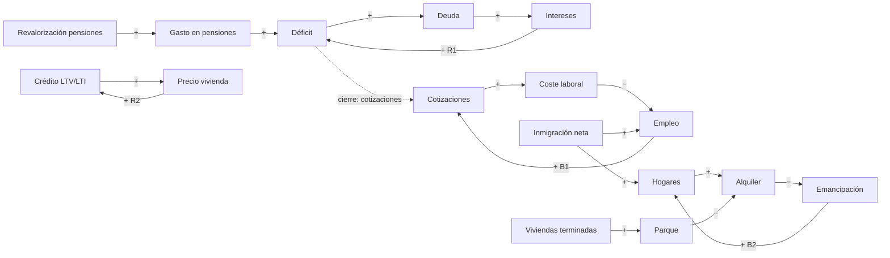

# Simulador del sistema: pensiones, impuestos, vivienda, empleo, sanidad y educación como un solo sistema

Fecha: 2026-10-19. Diseño (§1–§10), **corte 0** (§11) y **corte 1** (§12) publicados; **corte 2** (vivienda, §13) en `main`.

- **Dónde estamos.** Cinco verticales en `/visualizaciones/` (carga fiscal, empleo, educación, sanidad, vivienda), cada una
  con su exporter, sus fuentes con sha256 y cinco casos tipo compartidos ([VIZ-SEGMENTOS](../VIZ-SEGMENTOS-20261019/README.md)).
  El test de voto v2 tiene 29 afirmaciones respaldadas por 1.023 votaciones. Las piezas se leen por separado: nadie ve qué
  le pasa a la vivienda cuando se tocan las pensiones.
- **A dónde vamos.** Un simulador en `/visualizaciones/sistema/` donde el lector mueve palancas de política («subir las
  pensiones», «limitar el alquiler», «copago sanitario») y ve, en tiempo real, cómo se propaga el cambio por un mapa causal,
  cuánto cuesta, quién lo paga, qué les pasa a los cinco casos tipo y con qué incertidumbre. Cada palanca enlaza a cómo
  votó cada partido.
- **Qué sigue.** Cortes 0, 1 y 2 hechos (§11–§13): pensiones, cuentas públicas, impuestos con reparto por quintil y
  vivienda (obra, suelo, tope, turísticos, crédito; bucles B2 y R2) en `/visualizaciones/sistema/`. Siguiente: corte 3,
  empleo e inmigración (§9).

## 1. Qué tipo de modelo, y por qué

| Enfoque | Para qué sirve | Por qué sí o no aquí |
|---|---|---|
| **Dinámica de sistemas** (stocks y flujos, Forrester/Sterman) | Acumulaciones, retardos y bucles de realimentación | **Motor principal.** Es lo que usa En-ROADS (Climate Interactive/MIT), la referencia de simulador de políticas en el navegador: cientos de variables, resultados al mover el deslizador. |
| **Sistemas mínimos complejos** (MicroDYN, Funke/Greiff; Tailorshop, Dörner) | Ecuaciones lineales con entradas, salidas, inercia propia y efectos secundarios: el formato con el que la disciplina de *complex problem solving* mide cómo la gente explora y controla un sistema | **Forma de las ecuaciones y de la experiencia**: explorar la estructura primero, después intentar alcanzar objetivos (§5, modo reto). |
| **Microsimulación de impuestos y prestaciones** (EUROMOD de la JRC, calculadora TaxBEN de la OCDE) | Quién gana y quién pierde con un cambio de reglas, con hogares reales | **Capa de distribución, calculada fuera de línea**: tablas de incidencia por caso tipo y por celda edad × tenencia × quintil (los microdatos de la ECV ya están en la caché). |
| Mapas cognitivos difusos | Relaciones cualitativas | No como motor: los pesos no salen de datos. Sí para dibujar relaciones que aún no tienen número (aristas «sin cuantificar», §4). |
| Modelos de agentes, DSGE | Comportamiento emergente; equilibrio general | Fuera: no son trazables arista por arista ni corren en un navegador con rangos. Sus resultados publicados sirven para **calibrar** aristas. |

Decisión: **modelo modular de forma reducida**. Cada vertical es un submodelo pequeño de stocks y flujos con parámetros
calibrados (elasticidades, retardos) y su rango; los submodelos se conectan por unas pocas variables compartidas; la
distribución se resuelve con tablas precalculadas. El modelo no predice: muestra **diferencias frente a una línea base
oficial** documentada.

## 2. Arquitectura del sistema

### 2.1 El bus: las variables que conectan los módulos

Pocas variables compartidas, para que el acoplamiento sea legible:

- **Demografía**: población por etapa (16–29 / 30–44 / 45–64 / 65+), inmigración neta, hogares formados.
- **Trabajo**: ocupados, paro, salario medio real, horas.
- **Precios**: IPC, alquiler, precio de la vivienda, tipo de interés (el del BCE es contexto, no palanca).
- **Cuentas públicas**: ingresos por figura (IRPF, IVA, cotizaciones, sociedades, resto), gasto por función (COFOG),
  saldo, deuda, intereses.
- **Actividad**: PIB real (solo como denominador y para un multiplicador de corto plazo con rango; no hay modelo de
  crecimiento).

### 2.2 Los módulos

| Módulo | Stocks (lo que se acumula) | Flujos y relaciones clave | Datos ya en el repo |
|---|---|---|---|
| Pensiones | número de pensionistas, pensión media, fondo de reserva | altas por edad de jubilación, revalorización (se acumula: un punto de más se arrastra todos los años), cotizaciones y MEI | `carga-fiscal.json` (COFOG, ESSPROS por pensionista) |
| Cuentas públicas | deuda | saldo = ingresos − gasto; intereses = tipo medio × deuda (bucle que se refuerza) | `carga-fiscal.json` (`debt_interest`, composición) |
| Impuestos | — | recaudación estática por tipo × base; respuesta de la base con elasticidad y rango; incidencia por quintil | `carga-fiscal.json`, cuña fiscal en `empleo.json` |
| Vivienda | parque de viviendas, viviendas en alquiler (mercado / social / turístico), hogares, jóvenes no emancipados | obra iniciada → terminada (retardo 2–4 años), precio y alquiler frente a parque/hogares, crédito (LTV/LTI) → demanda, emancipación latente | `vivienda.json` (precio, esfuerzo, obra terminada, tipos), microdatos ECV |
| Empleo | ocupados por edad y formación, contratos temporales | coste laboral (SMI, cotizaciones, jornada) → empleo con elasticidad y rango; inmigración → población activa | `empleo.json` |
| Sanidad | médicos (MIR: retardo de 6–11 años), personas en lista de espera, cobertura | lista = entradas − salidas, salidas limitadas por capacidad; copago → uso (también del necesario); cobertura → necesidad no cubierta | `sanidad.json` (gasto, esperas, médicos, primaria) |
| Educación | cohortes por nivel, abandono, nivel formativo de la población | gasto/ratio → resultados (evidencia débil, rango ancho); 0–3 → empleo de las madres (corto plazo); formación → empleo y salarios (15–20 años) | `educacion.json` |

### 2.3 Cómo se ve el núcleo (ejemplo de bucles)



Bucles con nombre (R = se refuerza, B = se equilibra), que la interfaz rotula:
- **R1 deuda–intereses**: el déficit de hoy paga intereses mañana.
- **B1 cotizaciones–empleo**: financiar con cotizaciones encarece el empleo y devuelve parte de lo recaudado.
- **B2 demanda latente**: construir abarata, abaratar emancipa, emancipar crea hogares que absorben parte de lo
  construido (en España, la mitad de los de 25–34 vive con sus padres: el efecto sobre el precio es menor que el ingenuo).
- **R2 crédito–precio**: con oferta rígida, el crédito fácil se capitaliza en precio, y el precio sube la garantía.
- **Inmigración** une pensiones y vivienda en sentidos opuestos: más cotizantes, más hogares.

## 3. Cómo opera en tiempo real: las simplificaciones

No se recalcula la economía. Se separa lo caro (fuera de línea) de lo barato (en el navegador):

**Fuera de línea (Python, en el exporter):**
1. Línea base anual 2025–2050 desde proyecciones oficiales: población del INE, gasto en pensiones del Ageing Report de la
   Comisión y de la AIReF, cuentas de AMECO/IGAE. Cada serie con su URL y sha256, como en las verticales.
2. Calibración: cada arista con elasticidad central, baja y alta, retardo y fuente (§4).
3. Incidencia: tablas de cuánto cambia en euros al mes cada caso tipo y cada celda edad × tenencia × quintil por unidad de
   cada palanca (IRPF, IVA, cotizaciones, pensión, alquiler, copago), a partir de las reglas fiscales y de los microdatos.
4. Un JSON acotado (`system-model.json`, objetivo < 1 MB) con variables, ecuaciones, parámetros, palancas y tablas.

**En el navegador (JavaScript, en un web worker):**
- Pasos anuales; las ecuaciones trabajan en **desviaciones logarítmicas frente a la línea base**
  (`Δy_t = Σ ε · Δx_{t−retardo}`), los stocks integran sus flujos.
- No linealidades solo donde se conocen y cambian el resultado: intereses sobre deuda, techo de capacidad de la obra,
  colas de espera con capacidad máxima, suelos en cero.
- Incertidumbre: 200 simulaciones con los parámetros muestreados en su rango (hipercubo latino, semilla fija para que un
  enlace reproduzca el mismo resultado). ~50 variables × 25 años × 200 simulaciones ≈ 250.000 evaluaciones: decenas de
  milisegundos.
- La distribución no se simula: se leen las tablas de incidencia y se multiplican por el cambio de cada palanca y de
  cada variable del bus (precios, alquiler, empleo).

**Simplificaciones que se dicen en la página:**
- Economía pequeña y abierta: tipos del BCE, crecimiento europeo y productividad son escenarios, no resultados.
- Forma reducida: las elasticidades medidas con unas reglas pueden no valer con reglas muy distintas (crítica de Lucas);
  por eso cada palanca tiene un **rango de validez** y fuera de él la interfaz avisa.
- Linealidad cerca de la línea base: cambios grandes (bajar las pensiones un 30 %) se marcan como fuera de rango.
- Sin equilibrio general completo: solo los efectos que pasan por el bus.
- Casos tipo y celdas, no microdatos, en el navegador.

### 3.1 Tres capas de certeza (la regla más importante)

Cada resultado se descompone y se pinta con peso distinto:
1. **Aritmética contable** (casi cierta): un punto más de revalorización cuesta X € el primer año y se arrastra.
2. **Respuesta de comportamiento estimada** (rango): cuánto cae el uso con un copago, cuánto empleo con más cotización.
3. **Efectos de segunda ronda** (hipótesis): multiplicadores, emancipación inducida, formación → salarios en 20 años.

Y un **indicador de robustez** por resultado: «el signo es el mismo en todas las hipótesis» frente a «depende de la
elasticidad X (enlace al debate)». Así el simulador separa lo que el dato zanja de lo que sigue en disputa, que es la
misma idea que la figura consolidada de cada vertical.

## 4. La pieza que hacen los agentes: el catálogo de aristas

Cada relación causal es una ficha verificable (estimación: 50 variables, 120–150 aristas):

```yaml
id: alquiler_tope__oferta_alquiler
de: tope_alquiler_zonas_tensionadas
a: viviendas_en_alquiler_mercado
signo: "-"
forma: log-lineal
elasticidad: {baja: ..., central: ..., alta: ...}
retardo_anios: 1-3
fuente_principal: {url, cita, pais, periodo, metodo}
evidencia_espana: si | no | parcial
grado: A (cuasi-experimento en España) | B (estudio fuera de España) | C (consenso de manuales) | D (supuesto)
evidencia_en_contra: [...]
debate: alquiler_tope   # si es un parámetro disputado, la interfaz deja elegir escuela
```

- **Parámetros disputados** (tope del alquiler, elasticidad de la renta gravable, efecto empleo del SMI, efecto del
  gasto educativo) no se resuelven a escondidas: la ficha guarda cada escuela con su fuente y el lector elige o ve todas.
- La línea del mapa codifica el grado: continua (A), discontinua (B/C), punteada (D), y sin número si no hay cuantía.
- Producción con el bucle obligatorio de `AGENTS.md`: lista de trabajo por módulo con las aristas precargadas, piloto de
  un agente con 5 aristas variadas, medir, arreglar la herramienta, olas de ~5 aristas por agente agrupadas por fuente,
  validador mecánico (esquema, rangos ordenados, URL y cita presentes) y **revisión de calidad de 15 aristas al azar
  contra la fuente con regla de decisión fijada antes** (la lección de los efectos indirectos del test de voto).

## 5. Qué ve y qué puede hacer el lector

### 5.1 Palancas (lo que pidió el mantenedor, más las que lo hacen comparable)

| Área | Palancas | Afirmación del test v2 que enlaza |
|---|---|---|
| Pensiones | revalorización (IPC −2 … IPC +2), edad efectiva de jubilación, pensión mínima, MEI, destope de la base máxima | «Hay que ampliar las prestaciones sociales…» |
| Impuestos | tipos de IRPF por tramo, IVA general y reducido, cotizaciones, sociedades, patrimonio/sucesiones | «Antes que bajar impuestos, hay que mantener la recaudación…» |
| Vivienda | viviendas públicas/año, suelo liberado, LTV/LTI máximos, tope del alquiler (cobertura y %), límite al alquiler turístico, deducciones | «El Estado debería intervenir más en el alquiler…» |
| Sanidad | cobertura (incluidas personas en situación irregular), copago por visita o farmacia, dental público, plazas MIR, gasto por persona | «El derecho al aborto y a la eutanasia…» (parcial); sin afirmación directa de cobertura: se dice |
| Empleo | SMI, jornada máxima, cuota de autónomos, políticas activas | «Para crear empleo es mejor rebajar costes…», «Los autónomos que ganan menos del SMI…» |
| Educación | gasto por alumno, 0–3 gratuito, ratio, becas, FP, concierto | «Las familias deberían poder elegir centro…» |
| Contexto (no son política) | tipo del BCE, inmigración neta, crecimiento de la UE, productividad | «España debería endurecer su política migratoria…» (la inmigración es contexto y palanca) |

**Cierre presupuestario obligatorio.** Toda palanca con coste pide «¿cómo se paga?»: deuda (por defecto, y se dice),
IRPF, IVA, cotizaciones o recorte de otra función. Es la lección central del sistema: subir las pensiones con deuda, con
IVA o con cotizaciones son tres políticas distintas con ganadores distintos.

### 5.2 Vistas

1. **Mapa causal** (entrada): ~6 grupos (los módulos) que se abren a sus variables. Al mover una palanca el cambio viaja
   por las aristas, los nodos se colorean por su desviación y los bucles activos se rotulan. Clic en una arista: su ficha.
2. **Series**: línea base frente a escenario con banda de incertidumbre, 1–25 años; la «aritmética» y el «comportamiento»
   separados.
3. **Personas**: los cinco casos tipo compartidos (joven inquilina en Madrid, pareja con hijos, adulto con poca formación
   en el sur, pensionista propietario, profesional) con su cambio en euros al mes después de impuestos, vivienda y
   servicios, y la media nacional al lado.
4. **Presupuesto**: de dónde sale y adónde va cada euro del escenario; saldo y deuda.
5. **Votos**: para cada palanca movida, cómo votó cada partido en la dirección elegida, con las votaciones concretas.
6. **Reto** (complex problem solving): un objetivo y restricciones («bajar al 30 % lo que la persona 1 dedica al alquiler
   en 10 años sin subir la deuda»); el lector explora y la página puntúa. Retos curados, no generados.

### 5.3 Comparar y compartir
- Escenario A frente a B en la misma vista.
- Escenarios por partido **solo desde lo votado** (dirección y, si el texto votado la fija, magnitud: p. ej. el índice de
  actualización de rentas de una ley), nunca desde programas sin votación detrás.
- Estado en el **fragmento** de la URL (`#…`), nunca en la query.

## 6. Tres ejemplos de cómo responde

- **Subir las pensiones** (un punto por encima del IPC): la aritmética es casi cierta y se arrastra; el resto depende del
  cierre. Con deuda: R1 empieza a pesar a 10–15 años. Con cotizaciones: B1 devuelve parte y la persona 1 pierde neto. Con
  IVA: sube el IPC y el pensionista recupera menos de lo que parece. La persona 4 gana en todos; la 1 pierde en dos de tres.
- **Construir más**: retardo de 2–4 años; el alquiler baja menos de lo que dice el cociente parque/hogares porque B2 crea
  hogares; la emancipación sube, que también es un resultado.
- **Limitar el alquiler**: baja lo que pagan quienes ya alquilan (aritmética) y, según la escuela elegida, se reduce la
  oferta de alquiler de mercado y sube el acceso para quien busca. Separa al inquilino con contrato del joven que busca,
  y el indicador de robustez dice qué parte del resultado depende del debate.

## 7. Reglas de rigor propias del simulador

Las de `/visualizaciones/` siguen valiendo; además:
- Rótulo fijo: «Escenario de un modelo con supuestos visibles, no una predicción».
- Las frases causales llevan su fuente: «en el modelo, X empuja Y según [estudio]», con el grado de la arista.
- Ninguna cifra sin rango, salvo la capa contable.
- Cada palanca tiene rango de validez; fuera de él, aviso.
- La línea base es oficial y está enlazada; el simulador solo añade desviaciones.

## 8. Puertas de calidad (antes de publicar cada módulo)

1. **Identidades cierran**: presupuesto, población, parque de viviendas, en cada año y cada simulación.
2. **La línea base reproduce** las proyecciones oficiales que usa (p. ej. gasto en pensiones en % del PIB del Ageing
   Report) dentro de una tolerancia fijada.
3. **Vuelta atrás**: el módulo, puesto en un año pasado, reproduce el signo y el orden de magnitud de episodios conocidos
   (IVA del 18 al 21 % en 2012; SMI +22 % en 2019; revalorización del 8,5 % en 2023; tope catalán del alquiler de 2020;
   reforma de pensiones de 2013). Si no, se dice en la página.
4. **Catálogo**: todas las aristas con fuente y grado; revisión de calidad de la muestra aprobada.
5. **Rendimiento**: simulación completa con incertidumbre < 100 ms en un móvil medio; JSON < 1 MB.
6. Puerta de privacidad de siempre (`just site-artifact-gate`).

## 9. Por dónde empezar: cortes finos

| Corte | Contenido | Por qué en este orden |
|---|---|---|
| **0. Pensiones + cuentas públicas** | revalorización, edad, MEI; cierre por deuda/cotizaciones/IVA; R1 y B1; personas 1 y 4; vuelta atrás 2013 y 2023 | Mejor dato, mecánica limpia, ya hay pensión por pensionista en `carga-fiscal.json`. Construye toda la máquina (motor, catálogo, exporter, mapa, personas) con un solo módulo. |
| 1. Impuestos | IRPF, IVA, cotizaciones, sociedades con incidencia por quintil y caso | Reutiliza el cierre del corte 0. |
| 2. Vivienda | obra, crédito, tope, turístico, emancipación (B2, R2) | La más pedida y la más disputada: necesita el mecanismo de debates ya probado. |
| 3. Empleo e inmigración | SMI, jornada, cuota de autónomos, inmigración como contexto | Une pensiones (cotizantes) con vivienda (hogares). |
| 4. Sanidad y educación | copago, cobertura, MIR, colas; 0–3, gasto, abandono | Retardos largos y evidencia más débil: mejor con la máquina madura. |
| 5. Capa de votos y retos | escenarios desde lo votado, retos curados | Necesita palancas estables. |

**DoD del corte 0**: página `/visualizaciones/sistema/` con mapa, series, personas y presupuesto para 4 palancas; catálogo
de ~20 aristas con revisión de calidad; línea base dentro de tolerancia; dos vueltas atrás documentadas; tests del motor
ejecutados con Node sobre el mismo código del navegador; JSON con fuentes y sha256; publicado con `just site-publish`.

**Implementación técnica propuesta (KISS):**
- Especificación del modelo como datos (YAML en el repo: variables, ecuaciones en una mini-notación, parámetros, palancas,
  enlaces a afirmaciones y votaciones) → `scripts/export_public_viz_system.py` → `system-model.json`.
- Un solo motor en JavaScript, sin dependencias, ejecutado en el navegador (web worker) y en Node para los tests.
- Alternativa descartada por ahora: escribir el modelo en XMILE/Vensim y compilarlo con SDEverywhere (lo que usa En-ROADS)
  y PySD para pruebas en Python. Da herramientas maduras, pero el formato es menos legible para revisar aristas una a una y
  añade una cadena de compilación.

## 10. Lo que el simulador no puede decir

- Cuánto crecerá la economía, ni qué pasará con los tipos del BCE: son escenarios.
- Efectos de cambios de reglas muy alejados de lo observado (fuera del rango de validez).
- Comportamientos que no tienen estimación (aristas «D»): se muestran, pero se dicen supuestos.
- Resultados políticos o electorales de las medidas.

## 11. Corte 0: pensiones y cuentas públicas (hecho, 2026-10-19)

- **Página**: `/visualizaciones/sistema/` (`ui/site/app/visualizaciones/sistema/`). Palancas: revalorización sobre el IPC,
  edad efectiva de jubilación, cotización extra; cierre por deuda, cotizaciones o IVA; contexto de inmigración (sensibilidades
  oficiales) y tipos de mercado; supuesto en disputa (incidencia de la cotización empresarial). Vistas: figura consolidada
  «tres formas de pagar lo mismo», mapa causal (con la lista de relaciones activas en texto para móvil), series con banda,
  dos casos tipo (1 y 4), capas de certeza con robustez y supuesto clave, votaciones del Congreso por palanca, catálogo y
  pruebas. Estado en el fragmento de la URL.
- **Datos**: `scripts/export_public_viz_system.py` → `ui/site/public/visualizaciones/data/sistema.json` (98 KB) y `sistema.csv`.
  Línea base: anexo estadístico del Ageing Report 2024 (xlsx en `etl/data/raw/system_model/`, sha256 en el JSON) y cuentas
  de 2025 (EDP de Eurostat en `public-finance-es.db`); el resto del presupuesto constante en % del PIB. Casos tipo leídos de
  `carga-fiscal.json` (sha256), nunca recalculados.
- **Motor**: `engine.mjs`, sin dependencias; el navegador y `node --test` ejecutan el mismo código. 200 simulaciones en
  hipercubo latino con semilla fija: ~35 ms, así que no hizo falta un web worker. Los impuestos de cierre cubren el coste
  antes de los efectos de segunda ronda (como un presupuesto); estos van al déficit. Con todo lo demás dentro del año, el
  punto fijo divergía en sorteos extremos (traslado salarial alto + multiplicador alto).
- **Catálogo**: 24 fichas en `etl/data/manual/system_model/edges/` (2 propias, 22 de agentes), validadas y fusionadas
  con `scripts/system_model_kit.py`; revisión de calidad de 15 al azar con regla fijada antes: 5 bien, 10 corregidas
  con corrección exacta, 0 sin respaldo (`reviews/`, aplicadas con `apply-reviews`). Correcciones con efecto: multiplicador
  de transferencias 0,5 → 0,8; la prima de riesgo de la Comisión solo vale en su escenario de tensión.
- **Puertas** (`just system-model-refresh`; el test también corre en `site-build-frozen`): identidades de la deuda, cierre
  por impuestos, convergencia en todos los sorteos, capa contable sin comportamiento, determinismo y tiempo, fragmento de la
  URL, y 4 pruebas con tolerancia fijada antes: coste de la revalorización de 2023 (+13 % frente a la cifra del Gobierno,
  que no incluye clases pasivas; tolerancia ±15 %), IRP 2014–2017 (+0,15 % con el IPCA frente a −0,08 % con el IPC),
  deuda de 2034 sin cambios (109,3 % frente al 109,5 % del Debt Sustainability Monitor 2024) y sensibilidad de inmigración.
- **Resultado principal** (valores centrales): un punto de revalorización sobre el IPC desde 2026 suma 34 puntos de deuda
  en 2050; pagado con cotizaciones, el caso 1 pierde unos 32 € al mes en 2035 (de 17 a 51) y hay unos 62.000 empleos menos;
  con IVA, unos 16 €. El caso 4 gana unos 143 € al mes en 2035 en los tres casos.
- **Coste de los agentes**: piloto de 5 fichas, 5,7 M de tokens de entrada (61 turnos); tras los arreglos (lista en el
  prompt, hosts bloqueados en el kit, URL que funcionan), 0,5–1,2 M por ficha (2,9–7,0 M por agente de 5–6 fichas);
  revisor de 15 fichas, 28 herramientas. Lo que más turnos ahorraría la próxima vez: URL de documentos de trabajo del
  Banco de España ya comprobadas, una ayuda del kit que saque los enlaces PDF de una página de publicación de la Comisión,
  respaldo con curl cuando falla el TLS de Python (tesoro.es) y que `catalog` acepte `(?i)`.
- **Límites que la página dice**: la edad efectiva tiene efectos menores que la sensibilidad oficial de congelar la edad
  legal (+2,9 puntos en 2040), porque esa mueve la participación de todo el tramo de 55 a 74 años; el multiplicador de
  impuestos (0,5) y su persistencia son supuestos con rango ancho; no hay estimación española de la incidencia de la cotización.
- **Siguiente**: corte 1 (impuestos: IRPF, IVA y cotizaciones con incidencia por quintil, reutilizando el cierre), luego
  vivienda con el mecanismo de debates.

## 12. Corte 1: impuestos con reparto por quintil (hecho, 2026-10-19)

- **Palancas nuevas**: IRPF en todos los tramos, IRPF por encima de 60.000 €, IVA general, IVA reducido e Impuesto sobre
  Sociedades; el IRPF es además una cuarta forma de pagar (cierre). Las cotizaciones ya estaban.
- **Recaudación** (fichas T01–T07, agentes): por punto, IRPF 0,26 % del PIB (AEAT 2023), tramo alto 0,03 %, IVA reducido
  0,14 % (Memoria de Beneficios Fiscales), Sociedades 0,13 % (AEAT); reacción con la elasticidad de la renta gravable
  (general y alta, esta en disputa), la semielasticidad de la base de Sociedades y el traslado de Sociedades a salarios
  (en disputa). Con el valor central de la reacción de las rentas altas, subir el tramo alto no recauda: se dice en la
  página y se deja elegir la escuela.
- **Reparto** (`scripts/system_model_incidence.py`, sin red, reglas fijadas en su cabecera): quintiles de personas por
  renta disponible equivalente con los microdatos de la ECV 2025; base del IRPF por persona con las reglas generales de
  2024 (simplificadas); IVA con la estructura de gasto por quintil de la EPF de Eurostat (2015, antes de la pandemia;
  2020 como contraste) y el tipo de la Ley 37/1992 por grupo COICOP; cotizaciones por salarios; Sociedades entre capital
  y salarios; pensiones por pensiones. El navegador multiplica las cuotas por la recaudación del motor: la vista por
  quintil es la carga legal (antes de reaccionar), en euros al mes por hogar y en % de la renta disponible.
- **Casos tipo**: se añaden el 2 (pareja con hijos, dos sueldos) y el 5 (profesional), con la misma renta que en las demás
  páginas; ninguno llega al tramo de 60.000 €.
- **Puertas nuevas**: la cuota de gasto al tipo general (EPF + ley) frente a la ficha del IPCA (diferencia 0,05, tolerancia
  0,1); la concentración de la base (20 % superior: 48,3 % en la microsimulación frente al 50,9 % de la AEAT, ±10 puntos);
  el IVA es regresivo en el modelo y en la estadística experimental de Eurostat; el reparto suma exactamente la carga.
- **Resultado principal**: un punto más de IRPF en todos los tramos recauda unos 3.500 millones tras la reacción y pesa
  unas 5 veces más (en % de la renta) en el quintil más rico que en el más pobre; uno de IVA general, unos 4.800 millones,
  del 0,84 % al 0,54 % de la renta del primer al quinto quintil.
- **Límites**: la ECV recoge peor las rentas más altas (el reparto del IRPF sale algo menos progresivo); la EPF de 2015
  puede no reflejar el gasto actual; no hay declaración conjunta, mínimos familiares ni escalas autonómicas concretas.

## 13. Corte 2: vivienda (hecho, 2026-10-19)

- **Palancas**: vivienda pública en alquiler (miles al año, decidida desde 2026), suelo finalista liberado (viviendas
  posibles al año), límite al préstamo sobre el precio (LTP 90/80/70 %, la medida del Banco de España) y sobre la renta
  bruta (LTI 6 y 4,5), tope del alquiler en zonas tensionadas (cobertura y rebaja exigida) y retirada de viviendas
  turísticas. La inmigración del corte 0 (variantes ±33 % del Ageing Report) mueve ahora también los hogares. El coste
  neto de la vivienda pública entra en el cierre («¿Cómo se paga?»): con IVA, el caso 1 paga menos de 1 € al mes en 2035
  por 20.000 viviendas al año y su alquiler de un contrato nuevo baja unos 6 €.
- **Datos** (`scripts/system_model_housing.py`, reglas en su cabecera): hogares de la Proyección de Hogares del INE
  (tabla 54562, caché con sha256; después de 2040 crecen con la población del Ageing Report), obra terminada constante en
  la media 2023–2025 (94.700 al año: supuesto, nadie la proyecta), parque del Censo 2021 más lo terminado, viviendas
  turísticas (INE experimental, 1,28 %), inquilinos de mercado de la celda de la ECV, jóvenes de 25–34 en casa
  (Eurostat) y los casos tipo con los alquileres del SERPAVI de `vivienda.json` (sha256), sin recalcular. Puertas: hogares
  del INE frente a la EPA, viviendas por hogar entre 1,2 y 1,5, inquilinos de mercado entre el 12 % y el 25 %.
- **Motor** (`engine.mjs`, el mismo en el navegador y en `node --test`): el alquiler de mercado se mueve con las viviendas
  por hogar (elasticidad inversa de la demanda); los hogares latentes de jóvenes se emancipan al bajar el alquiler y
  recorren la mitad del camino cada año (B2); el precio sigue al alquiler y al saldo de crédito, y el crédito nuevo sigue al
  precio (R2); la obra privada responde al precio de dos años antes (B3) y la pública la desplaza en parte; el tope rebaja
  los contratos cubiertos (con su cumplimiento), saca pisos del alquiler y sube los no cubiertos; los inquilinos con
  contrato se acercan al mercado al renovar. Nuevas salidas `hs_*`, `p1_rent_*`, `p2r_rent_*`, `p2b_*`.
- **Catálogo**: 21 fichas nuevas (18 relaciones y 3 pruebas), 54 en total. Tres debates: salida de oferta con el tope
  (Cataluña sin caída de oferta, 0; Cataluña en contratos nuevos, ≈2; San Francisco, ≈0,6 con una rebaja supuesta),
  traslado de la escasez al alquiler no cubierto (0,85 San Francisco frente a 0 Cataluña) y desplazamiento de la obra
  privada (0,115 frente a 0,67). Grado D a la vista: coste total por vivienda pública (solo la ayuda, 39.800 €, está
  publicada), alquiler social, suelo que se construye, pisos turísticos que vuelven, crédito que desaparece con un límite,
  paso a alquilar, los umbrales de LTI y LTP distintos del 80 %.
- **Bucle de agentes** (AGENTS.md): piloto de 4 fichas, 61 turnos y 5,9 M de tokens de entrada (los mismos que en el corte
  0), casi todo buscando PDF. Arreglos: lista de URL comprobadas, regla de parar tras 3 intentos, ventana de texto en una
  llamada. Segunda ola (2 agentes): 35 y 59 turnos, 3,3 y 6,3 M; tercera (2): 45 y 50 turnos, 4,3 y 4,5 M (≈1 M por
  ficha). Lecciones: la lista de URL solo comprobaba el código HTTP y dos entradas eran otro documento (NBER w9255 y el DO
  2415 del Banco de España); el esqueleto no traía `extra_parameters` aunque el prompt los pedía. Lo que más turnos
  ahorraría: un buscador de mangos de `repositorio.bde.es` por número de documento, un `bde` para las tablas del Boletín
  Estadístico y un buscador de tablas del INE.
- **Revisión de calidad** (regla fijada antes; 10 de 21 sorteadas con semilla 20261019, publicable con ≥ 8 bien o
  corregidas y ninguna sin respaldo): 3 bien, 7 corregidas, 0 sin respaldo. Correcciones con efecto en la lectura: la
  rebaja de San Francisco (25 %) es nuestra, no del artículo; el 43,8 % de hipotecas con LTP > 80 % es de operaciones, no de
  volumen (el motor lo usa como volumen y se dice); el coste por vivienda es coste total, con la parte pública aparte.
  Los grados pueden ir ahora por parámetro (`extra_parameters[].grade`), porque varias fichas mezclan un dato publicado con
  supuestos.
- **Pruebas** (tolerancias fijadas el 2026-10-19 antes de rellenar las fichas, `backtests.mjs`): tope catalán de 2020
  (−4,0 % en el modelo frente al −5,0 % medido; ±50 %; no independiente: el cumplimiento sale del mismo estudio), burbuja
  2000–2007 (el término de crédito da cuenta del 46 % de la subida del precio en años de salario, frente a 30–100 % en los
  estudios, ±15 puntos; prueba débil porque la referencia es D; el canal de parque por hogar apunta al revés: se terminaron
  0,82 millones de viviendas más que hogares nuevos) y pisos turísticos en Barcelona (0,66 % por punto del parque en el
  modelo frente a 1,25 % en el cuasi-experimento; entre un tercio y el triple). Seis pruebas nuevas del motor: identidad
  del parque, B2 amortigua, el tope en la capa contable es exactamente la ley, R2 amplifica, convergencia en todos los
  sorteos, inmigración y alquiler.
- **Resultado principal** (2035, valor central y 5–95 %): 20.000 viviendas públicas más al año suman 96.000 viviendas
  (0,4 % de los hogares) y bajan el alquiler de un contrato nuevo un 0,7 % (0,4–0,9; 2,4 % en 2050) por unos 770 millones
  al año; los jóvenes que se emancipan ocupan un 3 % de lo construido, así que B2 resulta pequeño con estas fichas (la
  elasticidad de la demanda ya incluye parte de la formación de hogares). Un tope del 10 % sobre la mitad del alquiler de
  mercado baja un 4,0 % (3,0–5,4) el contrato cubierto y sube un 1,7 % (0,3–3,6) el no cubierto, con 66.000 pisos menos
  de alquiler; según la escuela, de ningún piso menos y ningún cambio fuera del tope (Cataluña, oferta total) a −132.000 pisos y +3,4 % (Cataluña, contratos nuevos).
  Retirar la mitad de los pisos turísticos: −0,5 %. Limitar la hipoteca al 80 % del precio y a 4,5 veces la renta: precio
  −5,5 % (−1,3 a −9,5), de los que R2 multiplica por 1,17; el alquiler sube un 1,0 % porque parte de los compradores
  alquila (supuesto D). Un tercio más de inmigración: alquiler +2,2 %.
- **Límites que la página dice**: un solo mercado nacional (sin barrios ni comunidades); los pisos que salen del alquiler
  con el tope no cambian el parque total; LTP y LTI independientes; la obra pública no tiene multiplicador; el esfuerzo por
  edad aplica el cambio del alquiler a todo el gasto en vivienda de la celda.
- **Siguiente**: corte 3, empleo e inmigración (SMI, jornada, cuota de autónomos), que une cotizantes y hogares. La capa
  de presentación se está rediseñando (escena ilustrada) en otra sesión sobre este corte.


## Rediseño ilustrado de la página (2026-10-19)

- **Por qué**: el mantenedor juzgó que el mapa de cajas no comunicaba. La página se rehízo de principio a fin con dibujos.
- **Qué hay ahora** (`ui/site/app/visualizaciones/sistema/scene/`): una escena ilustrada (tiendas, empresas, quien trabaja, la
  hucha pública, quien cobra pensión, servicios públicos, la pila de deuda, quien presta y la vivienda) con el dinero circulando
  en monedas animadas; el grosor de cada flujo es su peso en % del PIB y el número de color, el cambio del escenario; cada figura
  es un millón de personas y cada moneda de la pila, 10 puntos de deuda. Una línea de tiempo 2025–2050 con reproducción. Las
  palancas son tarjetas con icono en pestañas (pensiones, impuestos, vivienda), «¿Quién paga?» con cuatro opciones dibujadas y
  escenarios de ejemplo. Debajo: cuatro vecinos con cara que reacciona (Lucía, Ana y Javi, Carmen y Laura, los casos 1, 2, 4 y 5),
  la escalera de rentas con una casa por quintil, la cadena de causas paso a paso con la fuerza de su evidencia y su ficha, y las
  comparaciones de pensiones, impuestos y vivienda con iconos. Gráficos, tabla de capas de certeza y supuestos en disputa quedan
  plegados en «Los números».
- **Dos composiciones** de la escena (ancha y estrecha) para que en el móvil se lea sin encoger; respeta `prefers-reduced-motion`.
- El mapa de cajas (`CausalMap.js`, `HousingMap.js`) queda solo como fuente de los nodos y relaciones de la cadena.
